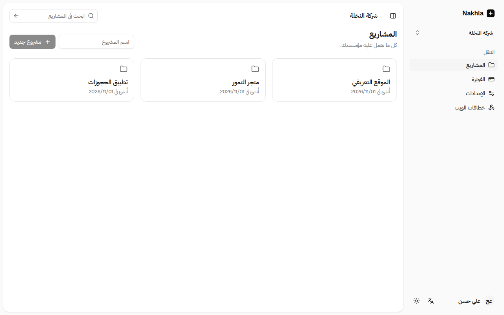
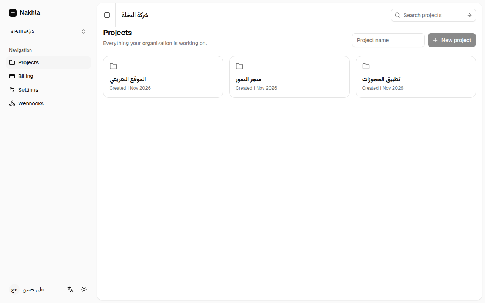
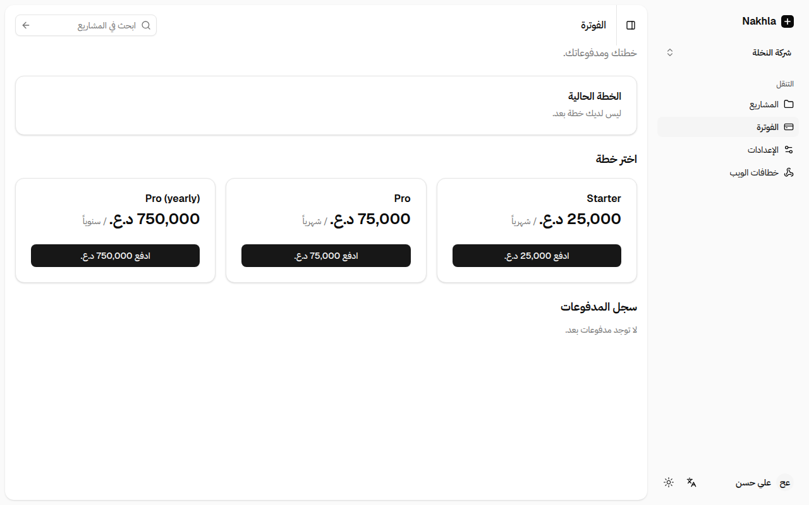
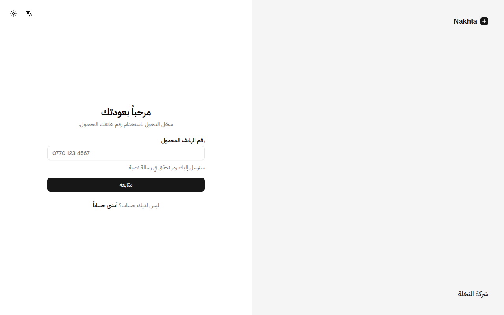
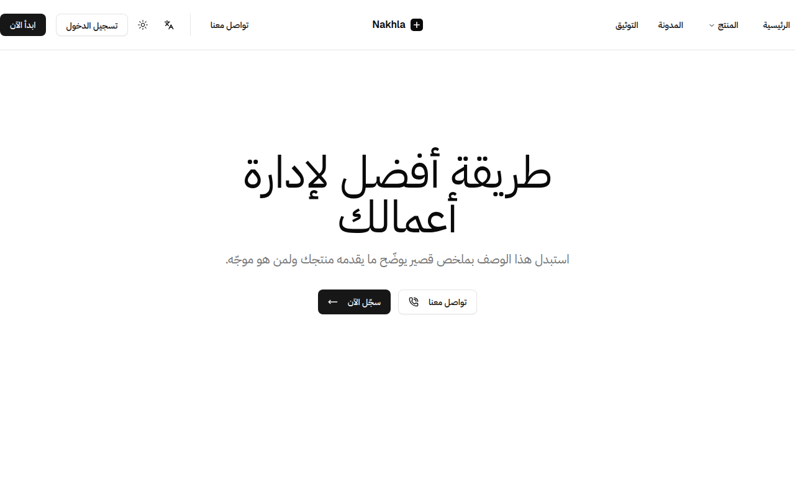
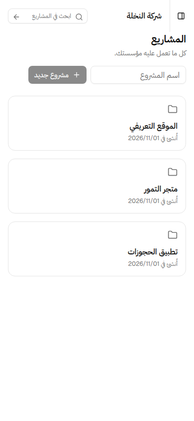

# A-SAAS · أساس

**The Arabic-first foundation for SaaS products and their mobile apps.**

*Asās* (أساس) means "foundation". A-SAAS is a production-ready monorepo for
products whose users speak Arabic: right-to-left done properly, phone sign-in,
regional payments, and the same app on the web, iOS and Android.

Most starters are English-first, Stripe-only and web-only. A-SAAS starts from
what products in Iraq, the Gulf and the wider region actually need.

## What you get

- **Arabic and English, RTL by default.** Every string is in the translation
  files. Layouts use logical CSS, so they mirror correctly. CI fails on
  physical Tailwind utilities or hard-coded UI text. Dates, numbers and money
  are formatted for the region, with Latin or Arabic-Indic digits.
- **Phone sign-in.** Supabase phone OTP accepts Arabic-Indic digits and local
  formats. A pluggable SMS hook covers local gateways, Twilio and WhatsApp.
- **Multi-tenant from day one.** Organizations, roles and invitations, all
  enforced by Postgres Row Level Security with a pgTAP test suite.
- **Payments that work in the region.** One provider interface, shipping with
  Wayl (Iraq: cards, Qi Card, ZainCash, FIB) and Stripe. Native apps follow
  App Store and Play rules on digital goods.
- **Web, iOS and Android from one codebase.** The product app is client-first
  and builds as a static export for Capacitor. Native auth uses PKCE and keeps
  the session in the Keychain or Keystore.
- **Ready for store review.** Includes in-app account deletion with
  sole-owner handling, privacy-safe analytics in the apps, and deep links.
- **Marketing that measures.** One `track()` call reaches GA4, Meta and
  TikTok, with server-side purchase conversions deduplicated against the
  browser event.
- **A generator, not a fork-and-pray.** `bun run init` fills in your names,
  applies a country preset, removes the modules you don't need and picks
  your project's license.

## Screenshots

<table>
  <tr>
    <td width="50%"></td>
    <td width="50%"></td>
  </tr>
  <tr>
    <td></td>
    <td></td>
  </tr>
  <tr>
    <td></td>
    <td align="center"></td>
  </tr>
</table>

The product app in Arabic and English, billing in Iraqi dinars, phone
sign-in, the marketing site and the app at phone size. These were taken from a project
generated with `bun run init --region IQ`.

## Quick start

You need [Bun](https://bun.sh) and, for the local database,
[Docker](https://docs.docker.com/get-docker/).

```sh
bun create theideaiq/a-saas my-product
cd my-product
bun run init        # interactive: names, country, language, license, modules
bun run db:start    # local Supabase (Docker)
bun run dev         # app :3000 · site :3001 · api :3002
```

`bun create` copies the template, installs dependencies and starts a fresh
Git history. You can also click **Use this template** on GitHub, or
`git clone` and `bun install`.

`bun run db:start` prints the local Supabase URL and keys; put them in the
`.env.local` files that `init` created. Then sign in locally with
`+964 770 000 0000` and the code `123456`.

### Country presets

| `--region` | Currency | Time zone | Payments to start with |
| --- | --- | --- | --- |
| `IQ` Iraq | IQD | Asia/Baghdad | Wayl |
| `SA` Saudi Arabia | SAR | Asia/Riyadh | Stripe, if available to you |
| `AE` UAE | AED | Asia/Dubai | Stripe |
| `EG` Egypt | EGP | Africa/Cairo | Stripe, if available to you |
| `JO` Jordan | JOD | Asia/Amman | Stripe, if available to you |

Each preset also sets the week start, phone format and example prices.
Adding a country is one entry in `scripts/template/regions.ts`.

## Stack

| Concern | Choice |
| --- | --- |
| Monorepo | Turborepo + Bun workspaces |
| Web | Next.js (App Router), React, Tailwind CSS v4, shadcn/ui |
| Auth & data | Supabase: Postgres, Row Level Security, phone OTP, Storage |
| Mobile | Capacitor (iOS + Android) from the product app |
| i18n | next-intl, Arabic + English (Kurdish ready) |
| Payments | `@repo/payments` with Wayl and Stripe |
| Analytics | GTM or GA4 + Meta + TikTok, PostHog, server-side conversions |
| Quality | TypeScript strict, Biome (Ultracite), Vitest, pgTAP, GitHub Actions |

Optional modules, all removable by `init`: CMS (BaseHub), real-time
collaboration (Liveblocks), notifications (Knock), outbound webhooks (Svix),
feature flags, rate limiting and AI helpers.

## Documentation

The docs site, **[theideaiq.github.io/a-saas](https://theideaiq.github.io/a-saas/)**,
is built from these files:

- [ARCHITECTURE_AND_INTEGRATIONS.md](./ARCHITECTURE_AND_INTEGRATIONS.md): how
  it fits together and step-by-step setup. It covers the generator, Supabase
  and RLS, the mobile apps, tracking, payments and Vercel.
- [AGENTS.md](./AGENTS.md): conventions for humans and AI coding agents.
- [CONTRIBUTING](./.github/CONTRIBUTING.md): how to contribute.

## Contributing

Issues and pull requests are welcome, especially new country presets, payment
gateways (Moyasar, Tap, HyperPay, Paymob…), SMS providers and translations.
Please read the [contributing guide](./.github/CONTRIBUTING.md) first.

## License

[MIT](./LICENSE.md). Projects you create with `bun run init` can use any
license; the generator offers proprietary or MIT and keeps the A-SAAS notice
in `THIRD_PARTY_NOTICES.md`. A-SAAS builds on
[next-forge](https://github.com/vercel/next-forge) and
[shadcn/ui](https://github.com/shadcn-ui/ui), both MIT.

Built and maintained by [The Idea IQ](https://github.com/theideaiq), created by
[@shaheenfarjo](https://github.com/shaheenfarjo).
